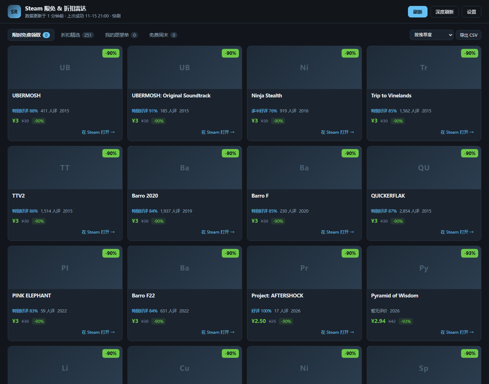

# Steam 限免 & 折扣雷达

一个在自己电脑上跑的小工具。点一下「刷新」，就能看到：

- **限时免费领取**：正在 100% 折扣、可以永久入库的游戏
- **折扣精选**：按折扣力度 + 口碑 + 热度打分排出来的打折游戏
- **我的愿望单**：你在等的游戏里，正在打折的那些
- **免费周末**：本周可以免费畅玩的（注意：这个只能玩，不能永久保留）

发现新的限免会弹桌面通知，也可以设成开机自动在后台刷新。



---

## 一、怎么用（三步）

**第 1 步：装 Python**

如果电脑里还没有 Python，去 <https://www.python.org/downloads/> 下载安装 3.10 或更高版本，
安装时**务必勾选** `Add Python to PATH`（这一步很关键）。

**第 2 步：双击 `启动.bat`**

会弹出一个黑色窗口（这是程序本体，别关它），然后浏览器自动打开界面：

```
http://127.0.0.1:8731
```

**第 3 步：点「刷新」**

第一次可能要等十几秒。看到游戏卡片就成功了。

> 不需要安装任何依赖包，全部用 Python 自带的功能实现。也不需要注册任何账号。

---

## 二、界面上的东西是什么意思

| 元素 | 说明 |
|---|---|
| **刷新** | 快速刷新，约 5~20 秒，只扫最相关的几页 |
| **深度刷新** | 多扫几十页，覆盖更全，约 1~3 分钟，适合隔几天跑一次 |
| **导出 CSV** | 把当前列表存成表格，能用 Excel 打开 |
| **数据源健康状态**（页面底部） | 每个接口这次成功还是失败、走的是直连还是代理。出问题时先看这里 |
| 右上角「数据更新于 X 分钟前」 | 数据的新鲜度。如果显示「缓存」，说明这次没连上 Steam |

卡片上：

- 绿色 `-75%` 是折扣力度，红色 `限时免费` 是限免
- `特别好评 96% 52,986 人评` 是口碑，好评率低于 70% 会变成黄色提醒你
- `剩 2 天 3 小时` 是促销剩余时间（**不是每款都有**，见下面说明）

---

## 三、设置里那几个开关

点右上角「设置」：

| 设置 | 建议 |
|---|---|
| **使用代理（加速器）** | 平时不用开。连不上 Steam 时，打开它并填写加速器的本地端口（Clash 一般是 `7890`，v2rayN 是 `10809`） |
| **发现新限免时弹通知** | 默认开。只在新出现限免时提醒，不会为普通打折骚扰你 |
| **开机自动启动** | 默认关。打开后会在后台静默运行（没有黑窗口），到点自动刷新 |
| **自动刷新间隔** | 默认 30 分钟。填 0 就是只在你手动点的时候刷新 |
| **深度刷新页数** | 默认 20 页（约 2000 条）。越大越全，也越慢 |
| **SteamID / 主页链接** | 填了之后能把愿望单接进来。「我的愿望单」标签页才有内容 |

### 填 SteamID 的注意事项

1. 打开 Steam → 个人资料 → 编辑个人资料 → 隐私设置
2. 把「**我的个人资料**」和「**游戏详情**」都设成**公开**
3. 把主页链接（形如 `https://steamcommunity.com/id/你的名字/`）整个粘进设置里
4. 点「同步愿望单」

如果愿望单是私密的，接口拿不到数据，这是 Steam 的限制，不是工具的问题。

---

## 四、常见问题

**Q：点刷新一直失败 / 一直显示「缓存」怎么办？**

Steam 商店的域名在国内是**时通时不通**的（实测同一小时内可以从正常变成完全连不上）。
工具已经做了三手准备：

1. 直连失败会自动再试一次代理
2. 都失败就立刻返回，不会让你干等（判断只需要约 14 秒）
3. 显示上次成功抓到的数据，并标出时间

如果反复失败：**打开你的加速器**，然后在设置里勾选「使用代理」填上端口，再刷新一次。

**Q：为什么「限时免费」经常是空的？**

限免活动本身就少 —— 一个月通常只有几次，而且多集中在周四前后。
空着是正常的，工具会在出现时弹通知。想看东西的话点「折扣精选」，那里永远有货。

**Q：为什么有些折扣没有倒计时？**

Steam 有两个接口：覆盖全站的那个**不提供**促销结束时间，提供结束时间的那个只给 10 条。
所以只有一部分游戏能显示倒计时，其余显示为空。这是数据源的限制，
**我们选择不显示，而不是编一个时间骗你。**

**Q：怎么确认某个游戏真的能领？**

点卡片右下角「在 Steam 打开」，以商店页面显示的「免费」和「领取」按钮为准。
工具里标 `medium` 可信度的条目（详情接口没连上时）建议点进去确认一下。

**Q：通知没弹出来？**

- 检查 Windows 设置 → 系统 → 通知，确认没有被关掉或开了「专注助手」
- 在设置里点「发送测试通知」验证一下
- 只有在**新出现**限免时才会弹，已经提醒过的不会重复弹

**Q：怎么关掉开机自启？**

设置里取消勾选即可。它写在注册表
`HKEY_CURRENT_USER\Software\Microsoft\Windows\CurrentVersion\Run` 里，键名 `SteamDealRadar`，
取消勾选会自动删除，不留垃圾。

**Q：会占很多资源吗？**

不会。不刷新的时候几乎不占 CPU；数据库几百 KB，跑一年也就几 MB。

---

## 五、它是怎么工作的

```
界面（浏览器）
   ↓ 点刷新
刷新编排器（限速、时间预算、直连/代理切换）
   ↓
三个数据源 ── 官方促销接口（带截止时间，10 条）
           ├─ 搜索接口（全站 9600+ 条，需解析 HTML）
           └─ 0 元专项筛选（找限免最省请求）
   ↓
规则引擎：三层判定「是不是限免」+ 折扣打分
   ↓
SQLite 缓存 + 桌面通知
```

**限免的三层判定**（少一层就会误报）：

1. 价格层：折扣 100% 且到手 0 元
2. 语义层：详情接口 `is_free = false` —— 排除「永久免费」游戏（它们本来就不要钱）
3. 类型层：`type = game` —— 排除 DLC、原声带、试玩；并单独识别「免费周末」（只能玩不能领）

**折扣推荐分** = 折扣力度 45% + 好评率 30% + 评价热度 15% + 新鲜度 10%，
好评率过低（<60% 且有足够评价数）会大幅降权。

---

## 六、目录结构

```
steam-deal-radar/
├─ 启动.bat              双击这个
├─ run.py                程序入口（本地服务 + 定时任务）
├─ app/
│  ├─ config.py          所有可调参数（域名、超时、阈值）
│  ├─ netlayer.py        网络：重试、退避、压缩、直连/代理切换、全局限速
│  ├─ parse.py           解析：三种 Steam 响应格式 → 统一结构
│  ├─ models.py          统一的数据结构 GameItem
│  ├─ rules.py           规则引擎：限免判定、折扣打分（纯函数）
│  ├─ steam.py           取数编排 + 坏了怎么办
│  ├─ db.py              SQLite 缓存与「新增」识别
│  ├─ notify.py          桌面通知 + 开机自启
│  ├─ toast_win.py       Windows 气泡通知（纯 ctypes，不依赖外部程序）
│  └─ server.py          本地 HTTP 服务
├─ web/                  界面（单页，无框架）
├─ tests/
│  ├─ fixtures/          真实抓取的响应样本（冻结，用于回归测试）
│  └─ test_parse.py      17 个测试
└─ data/                 运行时生成：数据库、日志、报错样本（不提交）
```

## 七、给改代码的人

```bash
# 跑测试（不需要联网，用的是 tests/fixtures 里的真实样本）
python -m unittest discover -s tests -v

# 只刷新一次并打印结果
python run.py --refresh-once

# 换个端口起服务
python run.py --port 8800
```

**Steam 改版了怎么办？**

1. 看 `data/errors/` 目录 —— 解析失败时原始响应会自动存下来
2. 对照样本改 `app/parse.py` 里的正则或字段名
3. 跑测试，确认没弄坏其他格式

所有接口地址、参数都集中在 `app/steam.py` 顶部，改 URL 不用动逻辑。

---

## 八、说明

- 数据全部来自 Steam 官方公开接口，仅供个人使用，不存储、不分发游戏内容
- 请求做了限速（最小 1.2 秒间隔）和单次刷新请求数上限，避免给 Steam 添麻烦
- 价格、活动以 Steam 商店页面为准；本地数据可能有延迟
- 版本记录见 [CHANGELOG.md](CHANGELOG.md)
